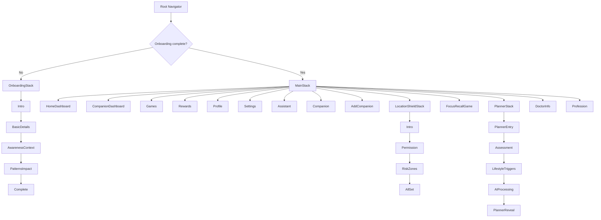

This project is organized around a root navigator that switches between onboarding and the main app flow.

### Navigation logic
- Root navigator decides whether user sees onboarding or app home.
- Main stack starts at:
  - CompanionDashboard if user role is companion
  - HomeDashboard otherwise
- Several feature flows are separated as nested stacks:
  - LocationShieldStack
  - PlannerStack
  - OnboardingStack

### Architectural interpretation
- App shell: root navigation
- Feature domains:
  - onboarding
  - dashboard/home
  - companion management
  - games and rewards
  - profile/settings
  - safety/location shield
  - recovery planning
  - doctor/profession info

If you want, I can also provide the same structure in a more detailed “module-wise architecture tree” including backend API and frontend folders.

## file structure

src/
│
├── screens/       → complete pages
├── components/    → reusable UI
├── navigation/    → screen navigation
├── context/       → shared state
├── hooks/         → reusable React logic
├── services/      → API/backend communication
├── utils/         → generic helper functions
│
└── App.tsx